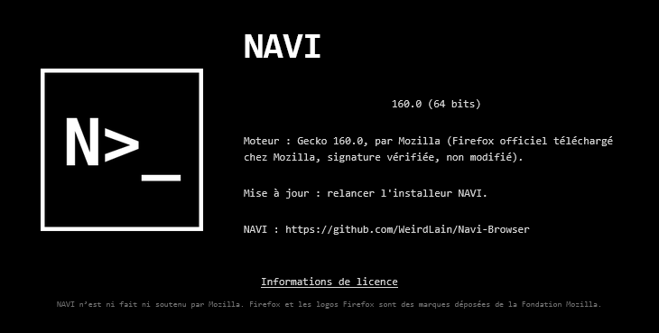
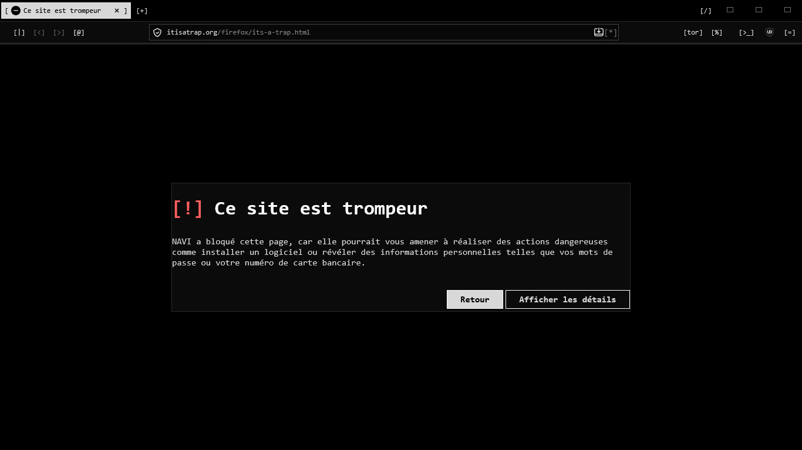
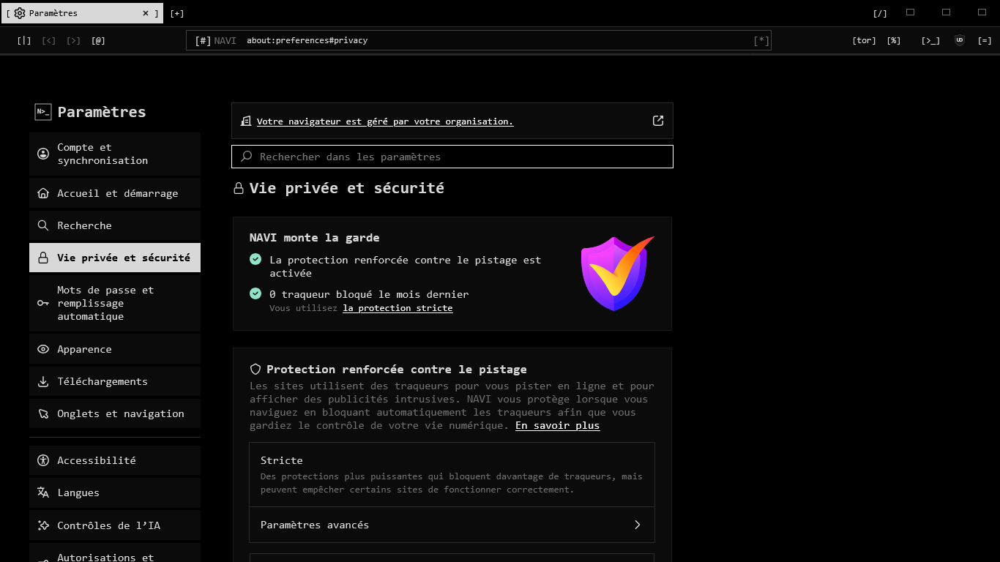
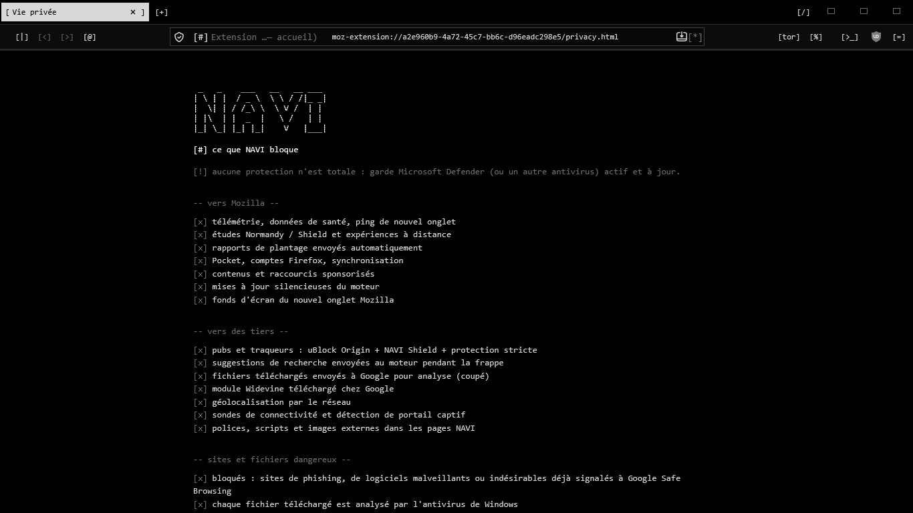

[English](README.md) | **Français**

```
 _   _    ___   __   __ ___
| \ | |  / _ \  \ \ / /|_ _|
|  \| | / /_\ \  \ V /  | |
| |\  | |  _  |   \ /   | |
|_| \_| |_| |_|    V   |___|
```

# NAVI 1.2.0 : installeur Windows

NAVI est un navigateur web pour Windows, réglé pour la vie privée, avec un thème noir et blanc façon terminal et son
propre nom et ses propres logos.

- **Moteur** : Gecko, le moteur de Firefox, **par Mozilla**. L'installeur ne contient **pas** Firefox : il télécharge la
  version officielle chez Mozilla au moment de l'installation, vérifie son empreinte et sa signature, et ne la modifie pas.
- **Fait maison** : la configuration, le nom et les logos NAVI, le thème, la page de nouvel onglet, les pages NAVI et
  quatre extensions :
  - **NAVI Shield**, un bloqueur de traqueurs 100 % local, actif dès la première seconde et hors ligne ;
  - **NAVI accueil**, la page de nouvel onglet et les pages NAVI ;
  - **navi-claude**, le pont local qui permet à Claude, sur le même ordinateur, de piloter NAVI ;
  - **hello**, un exemple d'extension.
- **Installé au premier démarrage depuis addons.mozilla.org** (pas inclus dans l'installeur, signé par Mozilla, mis à
  jour automatiquement) : **uBlock Origin**, bloqueur de pubs, de Raymond Hill.
- **Téléchargé par l'installeur chez torproject.org et vérifié** (pas inclus dans l'installeur) : **Tor** (le Tor Expert
  Bundle officiel), pour le bouton **[tor]** de la barre d'outils. Coupé par défaut, sans compte.
- Les sites modernes, les extensions Firefox, le gestionnaire de mots de passe et les outils de développement marchent
  comme dans Firefox.

**NAVI n'est ni fait ni soutenu par Mozilla, ni par le Tor Project, ni par l'auteur d'uBlock Origin.** Firefox est une
marque de la Mozilla Foundation ; « Tor » est une marque du Tor Project.

## Nouveautés de la 1.2.0

- **Bouton [tor]** : un clic fait passer tout NAVI par le réseau Tor, **sans compte**. Les sites voient une adresse de
  sortie Tor, pas ton IP. Voir « Bouton [tor] » plus bas : ce qu'il fait et ce qu'il ne garantit **pas**.
- **Proton VPN retiré** (il demandait un compte Proton) : la 1.2.0 le désinstalle des profils existants et le bloque.
- Une requête de moins au démarrage (le nombre de serveurs de Proton).

## Nouveautés de la 1.1.0

- **Nom et logos NAVI partout** (voir « Débrandage »), boîte À propos honnête : « Moteur : Gecko, par Mozilla ».
- **Sites dangereux bloqués** : Google Safe Browsing activé (phishing, logiciels malveillants, logiciels indésirables),
  **sans** envoyer à Google les fichiers téléchargés.
- **HTTPS obligatoire**, téléchargements HTTP depuis une page HTTPS bloqués, chaque fichier téléchargé analysé par
  l'antivirus de Windows.
- **Bloqueur de pubs** : uBlock Origin, aussi en navigation privée.
- Les extensions se mettent à jour toutes seules.

## Télécharger et vérifier

| Fichier | Rôle |
|---|---|
| `NAVI-Setup.exe` | l'installeur (environ 185 Ko) |
| `SHA256SUMS.txt` | son empreinte SHA-256 |

Pour vérifier le fichier, ouvre PowerShell dans le dossier du téléchargement et tape :

```powershell
Get-FileHash .\NAVI-Setup.exe -Algorithm SHA256
```

Le résultat doit être identique à la valeur de `SHA256SUMS.txt`.

**L'exécutable n'est pas signé** : Windows SmartScreen affichera « Windows a protégé votre ordinateur ».
Pour lancer quand même : **Informations complémentaires**, puis **Exécuter quand même**.
Ne le fais que si l'empreinte correspond.

## Prérequis

- Windows 10 ou 11, 64 bits.
- Aucun droit administrateur : tout s'installe pour ton compte seulement.
- Une connexion Internet pendant l'installation (environ 100 Mo chez Mozilla, environ 20 Mo chez torproject.org) et
  environ 450 Mo d'espace disque.
- Facultatif : **gpg** (Git pour Windows en contient un), pour que l'installeur vérifie aussi la signature OpenPGP de Tor.
- PowerShell 5.1 et .NET Framework 4, déjà présents dans Windows.
- **Python 3**, seulement pour le pont Claude. Le navigateur marche sans.
  L'installeur te prévient s'il manque : <https://www.python.org/downloads/>, en cochant « Add python.exe to PATH ».

## Ce que fait l'installeur, étape par étape

1. Il demande le dossier d'installation. Par défaut : `%LOCALAPPDATA%\NAVI`.
   Si ce dossier contient déjà NAVI, c'est une **mise à jour**, et ton profil (favoris, mots de passe, historique) est gardé.
   Il refuse un dossier qui n'est pas vide et qui ne contient pas NAVI.
2. Il refuse de continuer si NAVI est ouvert.
3. Il copie les fichiers NAVI : configuration, nom et logos, thème, extensions NAVI, pont Claude, outils, icône et scripts.
4. Il demande la dernière version de Firefox à `product-details.mozilla.org`.
   Il refuse d'installer une version **plus ancienne** que celle déjà installée (protection anti-retour).
   Si la version installée est déjà la dernière, il ne télécharge rien et réapplique seulement la configuration NAVI.
5. Il télécharge chez `archive.mozilla.org` l'installeur officiel de Firefox (Windows 64 bits, en français) et son fichier
   d'empreintes `SHA256SUMS`.
6. Avant d'exécuter quoi que ce soit, il vérifie que le SHA-256 de l'installeur correspond à `SHA256SUMS`, que sa
   signature Authenticode est valide et que le signataire est bien **Mozilla Corporation**.
7. Il extrait Firefox, sans l'installer dans le système, puis vérifie les signatures de `firefox.exe`, `xul.dll` et
   `updater.exe`, le numéro de version et le canal `firefox-mozilla-release`. **Aucun fichier de Mozilla n'est modifié.**
8. Il remplace le moteur sans jamais perdre celui qui marche (copie à part, puis deux renommages ; retour à l'ancien en
   cas d'échec ou de coupure).
9. Il applique la configuration NAVI à côté du moteur : `policies.json`, `autoconfig.js`, `navi.cfg` (obligatoires,
   vérifiés au SHA-256 près) et le dossier `navi-branding\` (nom et logos).
10. Il crée le raccourci **NAVI** sur le Bureau, dans le menu Démarrer et dans le dossier d'installation, avec l'icône NAVI
    et l'identifiant Windows de NAVI (pour que l'épingle de la barre des tâches s'appelle NAVI). Il ne déclare **pas** NAVI
    comme navigateur par défaut.
11. Il enregistre le pont Claude dans `HKCU\Software\Mozilla\NativeMessagingHosts\navi_bridge` (clé de ton compte, sans
    droits admin) et te dit si Python 3 est présent.

12. **Tor** : il cherche le dernier Tor Expert Bundle stable (Windows x86_64) sur `dist.torproject.org`, le télécharge
    avec `sha256sums-signed-build.txt` et vérifie **avant extraction** que le SHA-256 de l'archive correspond. Si gpg est
    présent, il vérifie aussi la signature OpenPGP de ce fichier par la clé « Tor Browser Developers »
    `EF6E286DDA85EA2A4BA7DE684E2C6E8793298290` (empreinte épinglée dans `build\install-tor.ps1`, clé publique prise
    chez `keys.openpgp.org` dans un trousseau temporaire). Une version plus ancienne que celle installée est refusée.
    Il extrait dans `tor\` (dossier NAVI) et écrit ce qui a été vérifié dans `tor\VERIFICATION.txt`. **Si cette étape
    échoue, NAVI s'installe quand même** et le bouton [tor] reste grisé, avec un message.

Au premier lancement, Firefox installe uBlock Origin depuis addons.mozilla.org (politique d'entreprise
`ExtensionSettings`), autorisé en navigation privée et épinglé dans la barre. Proton VPN (`vpn@proton.ch`, installé par
la 1.1.0) est en `blocked` : Firefox le désinstalle.

## Bouton [tor]

`[tor]` coupé, `[tor..]` connexion en cours, `[TOR]` actif, `[TOR!]` Tor arrêté par erreur.

- **Ce qu'il fait** : lance `tor.exe` (caché, client seulement, sans port de contrôle ni relais) seulement quand tu
  cliques, attend que Tor soit complètement amorcé (100 %), puis règle le proxy de NAVI sur le port SOCKS local de Tor.
  Les sites voient une adresse de sortie Tor, pas ton IP. Les noms de sites sont résolus par Tor (`socks_remote_dns`),
  pas par le DNS de ton système. WebRTC est coupé tant que Tor est actif (une visio ne peut pas révéler ton IP). Les
  fenêtres privées passent aussi par Tor, de même que les requêtes du navigateur (listes de Mozilla, Safe Browsing,
  alerte de version, mises à jour d'extensions). Re-cliquer arrête Tor et remet **exactement** les réglages réseau
  d'avant ; fermer NAVI l'arrête aussi, et Tor s'arrête seul si NAVI plante.
- **Fail-closed** : si `tor.exe` meurt pendant que le bouton est actif, le proxy reste en place, les pages échouent et
  un bandeau rouge le dit. NAVI ne repasse **jamais** en connexion directe sans te le dire : il passe aussi hors ligne, et
  `network.proxy.allow_bypass` et `network.proxy.failover_direct` sont verrouillés à false. Par défaut, Firefox réessaie
  **en direct** quand le proxy échoue (Remote Settings le fait) : vu pendant les tests, corrigé et revérifié.
- **Coupé à chaque démarrage** : relancer Tor en silence au démarrage serait une surprise.
- **Ce qu'il ne garantit PAS** : NAVI **n'est pas Tor Browser**. Ton empreinte de navigateur (taille de fenêtre,
  polices, extensions, réglages) reste reconnaissable ; les cookies et connexions sont ceux de NAVI. **Ne te connecte
  pas à tes comptes personnels si tu veux rester anonyme.** C'est plus lent, et certains sites bloquent Tor ou
  affichent des captchas. Les onglets déjà ouverts au moment du clic doivent être rechargés. Pour l'anonymat sérieux,
  utilise Tor Browser.
- **Limite de vérification** : `tor.exe` du Tor Expert Bundle n'a **pas** de signature Authenticode (vérifié sur
  16.0.1). Sans gpg, seul le SHA-256 publié en HTTPS par torproject.org est vérifié.

## Débrandage

NAVI remplace le nom « Firefox » et ses logos **sans modifier les fichiers de Mozilla** : textes de marque (titres de
fenêtres, À propos, paramètres, pages d'erreur, navigation privée, rapport de protection), logos et icônes des pages
internes, icône et identifiant Windows de toutes les fenêtres, liens « aide » et « en savoir plus » vers cette page,
illustration du renard retirée des pages d'erreur, menu Aide sans les services de Mozilla.

Ce qui reste, honnêtement :

- **Le Gestionnaire des tâches affiche « Firefox »** : c'est le nom inscrit dans le programme signé par Mozilla, qu'on ne
  modifie pas (sa signature est vérifiée).
- **Le User-Agent reste celui de Firefox** : le changer te rendrait plus facile à reconnaître et casserait des sites.
- La boîte À propos dit « Moteur : Gecko, par Mozilla » et la mention légale « Firefox est une marque de la Mozilla
  Foundation ».
- Quelques textes de Firefox citent Mozilla parce qu'ils parlent vraiment de Mozilla (réglages de télémétrie, coupés et
  verrouillés ; « Rechercher sur addons.mozilla.org » ; page des licences), une infobulle d'about:addons dit encore
  « Firefox ne recommande que… », et `about:policies` liste les noms techniques des politiques (`DisableFirefoxStudies`…).

## Les domaines contactés

### Pendant l'installation

| Domaine | Quand | Ce qui est envoyé |
|---|---|---|
| `product-details.mozilla.org` | 1 fois | une requête GET de la liste publique des versions de Firefox |
| `archive.mozilla.org` | 1 fois (sauf si le moteur est déjà à jour) | deux GET : l'installeur Firefox (environ 96 Mo) et `SHA256SUMS` |
| `dist.torproject.org` | 1 fois (sauf si Tor est déjà à jour) | GET : listes des versions, le Tor Expert Bundle (environ 20 Mo), `sha256sums-signed-build.txt` et son `.asc` |
| `keys.openpgp.org` | 1 fois, seulement si gpg est présent | la clé publique des développeurs de Tor Browser (par empreinte épinglée) |

Ce sont des requêtes HTTPS ordinaires. Le serveur voit ton adresse IP et l'agent « PowerShell ». Aucun identifiant n'est envoyé.

### Pendant l'utilisation

Mesure réelle : NAVI fraîchement installé par cet installeur, profil neuf, laissé **30 minutes sans rien faire**
avec le bouton [tor] coupé (198 requêtes, **toutes dans les 36 premières secondes**, puis plus rien pendant 29,5 min ; 11 connexions TCP, toutes vers les serveurs ci-dessous ; aucun `tor.exe` lancé).

| Domaine | Quand | Pourquoi / ce qui est envoyé |
|---|---|---|
| `firefox.settings.services.mozilla.com` | au premier démarrage, puis toutes les 24 h | Remote Settings : listes de sécurité signées (révocations CRLite, anti-pistage, extensions dangereuses…). 43 requêtes. |
| `firefox-settings-attachments.cdn.mozilla.net` | idem | fichiers de ces listes : environ 20 Mo au premier démarrage, puis quelques centaines de Ko. 98 requêtes. |
| `content-signature-2.cdn.mozilla.net` | idem | certificats qui vérifient la signature de chaque liste (une liste altérée est refusée). 40 requêtes. |
| `product-details.mozilla.org` | 1 fois par démarrage | alerte de version : liste publique des versions de Firefox, sans cookie ni cache. 1 requête. |
| `safebrowsing.googleapis.com` | au démarrage puis environ toutes les 30 min | Google Safe Browsing v5 : mise à jour des listes de préfixes de hachage (la clé d'API publique de Firefox est dans l'URL). 1 requête dans la fenêtre mesurée. Plus une demande de hachages complets quand une adresse visitée correspond à un préfixe. |
| `addons.mozilla.org` | au premier démarrage | téléchargement d'uBlock Origin (fichier signé par Mozilla). |
| `versioncheck-bg.addons.mozilla.org` | au premier démarrage, puis 1 fois par jour | mises à jour des extensions : l'identifiant et la version de chaque extension d'AMO, la version du moteur. 1 requête. |
| `ublockorigin.github.io`, `ublockorigin.pages.dev`, `cdn.jsdelivr.net`, `filters.adtidy.org`, `pgl.yoyo.org`, `malware-filter.gitlab.io`, `publicsuffix.org` | au premier démarrage, puis quand une liste expire (en général tous les quelques jours) | uBlock Origin : téléchargement de ses listes de filtres. 13 requêtes. |
| autorité de certification d'un site (OCSP) | en visitant un site dont le certificat n'est pas couvert par CRLite | le numéro du certificat vérifié : l'autorité apprend quel site tu visites |
| les sites que tu ouvres, et ton moteur de recherche (DuckDuckGo par défaut) | quand tu les utilises | comme dans tout navigateur ; la recherche ne part que quand tu valides |
| relais Tor (entrée, milieu, sortie) | **seulement quand le bouton [tor] est actif** | tout le trafic de NAVI, chiffré dans le réseau Tor ; les sites ne voient que l'adresse du relais de sortie |

Ces requêtes ne portent ni cookie ni identifiant NAVI. Chaque serveur voit ton adresse IP, la version du moteur et des
éléments d'empreinte ordinaires (en-têtes TLS/HTTP de Firefox).
**Google** (Safe Browsing) voit en plus, quand l'adresse d'une page ressemble à une adresse signalée, quelques préfixes
de hachage de 4 octets (pas l'adresse elle-même). Rien n'est envoyé à `sb-ssl.google.com` : **aucune information sur
les fichiers téléchargés ne part chez Google.**
**Pas de télémétrie, pas d'études, pas de rapports de plantage, pas de Pocket, pas de contenus sponsorisés.**

## Ce qui n'est PAS garanti

- **Pas de protection totale contre les logiciels malveillants** (ça n'existe pas). Safe Browsing ne bloque que les
  adresses **déjà signalées** à Google ou Mozilla : un programme malveillant nouveau, ou hébergé sur une adresse encore
  inconnue, n'est pas détecté. Test réel : les pages de test de phishing et de malware de Google et de Mozilla sont
  bloquées, mais les **fichiers de test de Google (« bad URL » `content.exe`, `badrep.exe`, `pua.exe`…) ne le sont pas**,
  car Google ne les signale que par l'analyse distante des téléchargements, coupée pour ne rien lui envoyer.
  Seul l'antivirus de Windows analyse les fichiers : **garde Microsoft Defender actif et à jour.**
- **Pas de protection contre un logiciel malveillant déjà présent sur l'ordinateur.**
  Un programme qui tourne sous ton compte peut lire ou modifier NAVI, son profil ou ses scripts.
- **CRLite n'est pas une protection complète contre les certificats révoqués** : lors des essais, 3 certificats révoqués
  de test sur 5 ont été refusés ; les 2 autres (SSL.com EV, DigiCert G5) ont été acceptés, même avec OCSP actif.
- **L'installeur n'est pas signé** : avertissement SmartScreen. Vérifie l'empreinte SHA-256.
- **Le Gestionnaire des tâches affiche encore « Firefox »** (voir « Débrandage »).
- **[tor] n'est pas Tor Browser** : il cache ton IP aux sites, pas ton identité (voir « Bouton [tor] »).
- **Pas de mises à jour automatiques du moteur.** NAVI t'alerte au démarrage quand un Firefox plus récent existe (bandeau
  rouge et fenêtre), ou s'il n'a pas pu vérifier. Pour mettre à jour, relance l'installeur. Les extensions, elles, se
  mettent à jour seules.
- **La protection stricte contre le pistage peut casser certains sites** : ajoute une exception avec le bouclier de la
  barre d'adresse. Même chose pour HTTPS obligatoire (bouton « Continuer vers le site HTTP »).
- **Le pont Claude a besoin de Python 3.**
- **Pas de DRM** : Netflix, Disney+, Spotify web et les autres services protégés ne liront pas leurs contenus.
- **Pas de traduction de pages ni d'IA intégrée.**

## Mettre à jour

Relance `NAVI-Setup.exe` et choisis le même dossier. Ton profil est gardé.
Une version de Firefox plus ancienne que celle installée est refusée.

## Désinstaller

NAVI fermé, ouvre PowerShell et tape (avec ton dossier d'installation) :

```powershell
powershell -ExecutionPolicy Bypass -File "$env:LOCALAPPDATA\NAVI\build\uninstall-windows.ps1"
```

Le script demande confirmation, puis demande s'il faut aussi supprimer le profil (favoris, mots de passe, historique).
Il arrête le `tor.exe` de NAVI s'il tourne encore, puis retire le dossier (`tor\` compris), les raccourcis du Bureau
et du menu Démarrer et la clé `navi_bridge`, seulement s'ils pointent vers ce dossier. Options : `-KeepProfile` garde `profile\` ; `-Yes` supprime sans poser de question (profil compris, sauf avec
`-KeepProfile`).

## Installation sans question

Pour un déploiement, ces variables d'environnement remplacent les questions :

- `NAVI_INSTALL_DIR` : le dossier d'installation ;
- `NAVI_SHORTCUT_DIR` : le dossier du raccourci, au lieu du Bureau ;
- `NAVI_STARTMENU_DIR` : le dossier du raccourci du menu Démarrer ;
- `NAVI_NOPAUSE=1` : pas de pause à la fin.

## Captures

Prises sur un profil neuf, juste après l'installation.

![Nouvel onglet NAVI, avec [tor], [>_] et uBlock Origin dans la barre](captures/nouvel-onglet.png)

![Bouton [tor] actif : check.torproject.org confirme que Tor est utilisé](captures/tor-actif.png)








