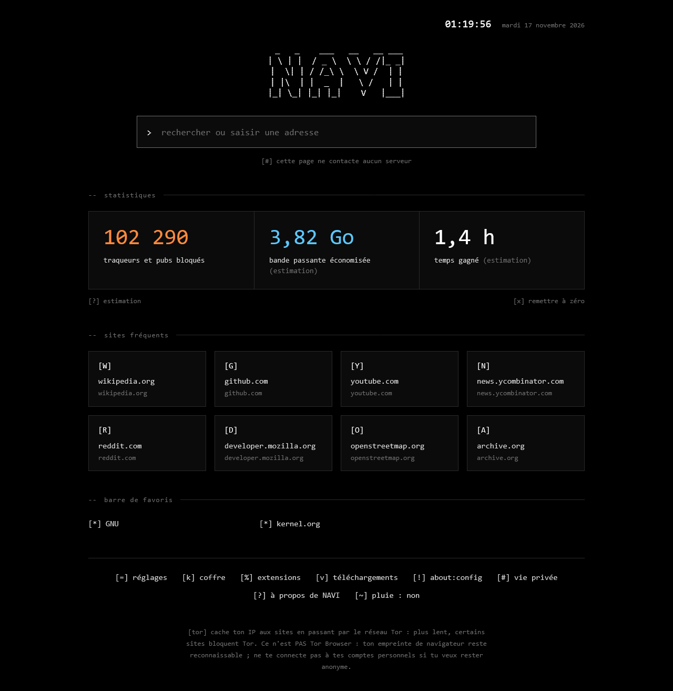

**English** | [Français](README.fr.md)

```
 _   _    ___   __   __ ___
| \ | |  / _ \  \ \ / /|_ _|
|  \| | / /_\ \  \ V /  | |
| |\  | |  _  |   \ /   | |
|_| \_| |_| |_|    V   |___|
```

# NAVI 1.2.5: Windows installer

NAVI is a privacy-tuned web browser for Windows, with a black-and-white terminal-style theme and its own name and logos.
Its interface is in French.

- **Engine**: Gecko, Firefox's engine, **by Mozilla**. The installer does **not** contain Firefox: it downloads the
  official release from Mozilla at install time, checks its hash and signature, and does not modify it (a copy named
  `navi.exe` only carries the NAVI name and icon: see "navi.exe").
- **Home-made**: the configuration, the NAVI name and logos, the theme, the new tab page, the NAVI pages and four
  extensions:
  - **NAVI Shield**, a 100% local tracker blocker, active from the first second and offline;
  - **NAVI home**, the new tab page and the NAVI pages;
  - **navi-claude**, the local bridge that lets Claude, on the same computer, drive NAVI;
  - **hello**, a sample extension (not loaded by default since 1.2.2).
- **Installed on first start from addons.mozilla.org** (not bundled in the installer, signed by Mozilla, updated
  automatically): **uBlock Origin**, ad blocker, by Raymond Hill.
- **Downloaded by the installer from torproject.org and verified** (not bundled in the installer): **Tor** (the
  official Tor Expert Bundle), for the **[tor]** toolbar button. Off by default, no account needed.
- Modern websites, Firefox extensions, the password manager and the developer tools work as in Firefox.

**NAVI is not made or endorsed by Mozilla, by the Tor Project, or by the author of uBlock Origin.** Firefox is a
trademark of the Mozilla Foundation; "Tor" is a trademark of the Tor Project.

## What's new in 1.2.5: a real Windows browser, no Firefox install needed

Also includes 1.2.4 (never published). Same Gecko engine (Firefox 160.0.1).

- **Firefox does not need to be installed**: NAVI keeps its own engine in its folder (extracted from Mozilla's package,
  never installed into Windows) and uses nothing from a Firefox present on the computer. Checked by running a copy of
  NAVI **without even `firefox.exe`**: no file from an installed Firefox is loaded.
- **Recognised by Windows as a browser, named NAVI**: Settings > Apps > **Default apps** (http, https, .htm, .html,
  .shtml, .xht, .xhtml, .pdf), "Open with", **Installed apps** (publisher WeirdWired, uninstallable from there), `navi` in
  Run (Win+R). Nothing is forced: you choose NAVI in Windows.
- A link opened from another app goes to the running NAVI, or starts NAVI on **its own** profile.
- Removed from the engine: Mozilla programs that announced themselves as "Firefox" to Windows and were not used by NAVI
  (`helper.exe` uninstaller, maintenance service, default browser agent, updater, `pingsender`, `crashreporter`,
  `private_browsing.exe`).
- **Lighter Tor**: 74 → 34.5 MB (bridges and `tor-gencert` removed, NAVI does not use them; licences kept).
- **Local-network HTTP guaranteed**: local IP addresses (127.x, 10.x, 192.168.x, 172.16-31.x: NAS, router, home servers)
  stay on `http://`, never forced to https (locked setting, tested).
- `navi.exe`: publisher WeirdWired and NAVI version in its properties.
- Measured: home page ready in 1.06 s on first start, 0.81 s after (fresh profile).

## What was new in 1.2.3: a cleaner project

No feature or protection changed; the same engine (Firefox 160.0) and the same `navi.exe`.

- NAVI no longer adds a "NAVI private browsing" shortcut to the Start menu: it started `private_browsing.exe`, which runs
  `firefox.exe` (shown as "Firefox" in the Task Manager) instead of `navi.exe`.
- Documentation gathered in a `docs` folder (privacy, security, extensions, Linux, theme), installed with NAVI, plus a
  `CHANGELOG.md` and a single `VERSION` file.
- Images recompressed without loss; smaller installer (199,680 bytes instead of 204,288).
- Checked again: fresh install, update from 1.2.2 with the profile kept, uninstall, and a 30-minute idle network audit
  (same domains as 1.2.2).

## What was new in 1.2.2: less memory, less CPU

Measured on the same PC (Windows 11, 32 GB RAM), NAVI 1.2.1 against 1.2.2, fresh profile each time, one copy running at
a time, **median of 3 runs**. "Memory" = sum of the private memory (USS, as in `about:processes`) of all NAVI processes.
CPU at rest = share of **one** core used while nothing happens (60 s).

| Scenario | 1.2.1 | 1.2.2 | Change |
|---|---|---|---|
| Home page only, at rest: memory | 704 MB | 611 MB | **−13 %** |
| Home page only: processes | 9 | 6 | −3 |
| Home page only: CPU at rest | 9.4 % | 4.4 % | **−53 %** |
| Time until the home page is ready | 1.18 s | 1.05 s | **−11 %** |
| 10 local test pages (5 sites × 2): memory | 1,194 MB | 966 MB | **−19 %** |
| same: processes / CPU at rest | 19 / 5.7 % | 11 / 1.4 % | −8 / **−75 %** |
| same, after 10 min idle: memory | 1,155 MB | 927 MB | **−20 %** |
| 10 real websites (*): memory | 1,539 MB | 1,396 MB | **−9 %** |
| same: processes / CPU at rest | 21 / 6.0 % | 17 / 1.5 % | −4 / **−75 %** |
| same, after 10 min idle: memory | 1,451 MB | 1,300 MB | **−10 %** |
| Inactive tabs unloaded (3 tabs, separate test) | — | −159 MB | |

(*) fr/en.wikipedia.org, news.ycombinator.com, old.reddit.com, github.com, developer.mozilla.org, duckduckgo.com,
lemonde.fr, archlinux.org, rust-lang.org. Real sites change from one run to the next: these figures are noisier.
**Test conditions**: copies run on a hidden Windows desktop, without a GPU (software rendering), so the CPU figures are
higher than on a normal screen; your numbers will differ, the direction should not. The 30-minute unloading does not
show up in the "after 10 min" lines.

What changed (all defaults, changeable in `about:config`; **no security or privacy feature was turned off**: site
isolation, sandbox, Safe Browsing, CRLite, uBlock Origin and NAVI Shield stay on):

- **Tabs unused for 30 minutes are unloaded** (`navi.memory.unloadAfterMinutes`, 0 = never): the tab stays in the tab
  bar and reloads when you click it (address, history and scroll position kept). Never the visible tab, pinned tabs,
  tabs playing sound, picture-in-picture, video calls / screen sharing, private windows, a form being filled in, or a
  page that asks before leaving.
- **One process per site** instead of up to four (`dom.ipc.processCount.webIsolated` = 1). Sites stay isolated from
  each other; a very heavy page can slow down other tabs **of the same site**.
- **1 process prepared in advance** instead of 3, and Firefox's old home page process is no longer kept alive.
- **Home page**: the logo "glitch" now runs 0.56 s every 7 s instead of keeping the display busy all the time; the page
  shows as soon as its own extension is loaded.
- **hello** (sample extension) is no longer loaded: it added a `[navi]` badge, readable by websites, to every https
  page. **navi-claude** only adds its console capture to pages while the Claude bridge is connected.
- Rejected after measuring (no gain, or a visible cost): smaller back/forward cache (back button 4× slower), image
  cache and memory cache limits. Network prefetching was already off since 1.0.
- Network: no new connection (30-minute idle audit, same list as 1.2.1).
- Linux: not tested and not published; the plan is in `docs/LINUX.md` in the NAVI folder.
## What was new in 1.2.1

- **New home page**: airy, readable layout in a centred column (search, statistics, frequent sites as a grid of tiles
  with full labels, bookmarks toolbar, links), readable at 100% zoom from 1024×768 to 1920×1080.
- **Local statistics, like Brave's**: trackers and ads blocked (a real local count of requests blocked by NAVI Shield,
  uBlock Origin and Firefox's tracking protection, private windows included), bandwidth saved and time saved (two
  documented estimates). Only totals are kept in your profile: no address, no site name, **nothing is sent**.
  See "Home page statistics".
- **"NAVI" in the Task Manager** instead of "Firefox", child processes included, through `navi.exe`, a copy of
  `firefox.exe` with only its name and icon changed. Trade-off: `navi.exe` is **not signed**. See "navi.exe".

## What was new in 1.2.0

- **[tor] button**: one click routes all of NAVI through the Tor network, **no account**. Websites see a Tor exit
  address, not your IP. See "[tor] button" below for what it does and does **not** guarantee.
- **Proton VPN removed** (it needed a Proton account): 1.2.0 uninstalls it from existing profiles and blocks it.
- One less request at startup (Proton's server count).

## What was new in 1.1.0

- **NAVI name and logos everywhere** (see "Debranding"), honest About box: "Engine: Gecko, by Mozilla".
- **Dangerous sites blocked**: Google Safe Browsing enabled (phishing, malware, unwanted software), **without** sending
  downloaded files to Google.
- **HTTPS-Only**, HTTP downloads from HTTPS pages blocked, every downloaded file scanned by the Windows antivirus.
- **Ad blocker**: uBlock Origin, in private browsing too.
- Extensions now update themselves.

## Download and verify

| File | Purpose |
|---|---|
| `NAVI-Setup.exe` | the installer (about 210 KB) |
| `SHA256SUMS.txt` | its SHA-256 hash |

To check the file, open PowerShell in the download folder and type:

```powershell
Get-FileHash .\NAVI-Setup.exe -Algorithm SHA256
```

The result must match the value in `SHA256SUMS.txt`.

**The executable is not signed**: Windows SmartScreen will show "Windows protected your PC".
To run it anyway: **More info**, then **Run anyway**. Only do so if the hash matches.

## Requirements

- Windows 10 or 11, 64-bit.
- No administrator rights: everything is installed for your account only.
- An Internet connection during installation (about 100 MB from Mozilla, about 20 MB from torproject.org) and about
  450 MB of disk space.
- Optional: **gpg** (Git for Windows includes one) so the installer can also check the OpenPGP signature of Tor.
- PowerShell 5.1 and .NET Framework 4, already part of Windows.
- **Python 3**, only for the Claude bridge. The browser works without it.
  The installer tells you if it is missing: <https://www.python.org/downloads/>, ticking "Add python.exe to PATH".

## What the installer does, step by step

1. It asks for the install folder. Default: `%LOCALAPPDATA%\NAVI`.
   If that folder already contains NAVI, this is an **update** and your profile (bookmarks, passwords, history) is kept.
   It refuses a folder that is not empty and does not contain NAVI.
2. It refuses to continue while NAVI is open.
3. It copies the NAVI files: configuration, name and logos, theme, NAVI extensions, Claude bridge, tools, icon and scripts.
4. It asks `product-details.mozilla.org` for the latest Firefox version.
   It refuses to install a version **older** than the one already installed (anti-rollback).
   If the installed version is already the latest, it downloads nothing and only reapplies the NAVI configuration.
5. It downloads from `archive.mozilla.org` the official Firefox installer (Windows 64-bit, French) and its `SHA256SUMS`
   file.
6. Before running anything, it checks that the installer's SHA-256 matches `SHA256SUMS`, that its Authenticode signature
   is valid and that the signer is **Mozilla Corporation**.
7. It extracts Firefox, without installing it system-wide, then checks the signatures of `firefox.exe`, `xul.dll` and
   `updater.exe`, the version number and the `firefox-mozilla-release` channel. **No Mozilla file is modified.**
8. It replaces the engine without ever losing the working one (separate copy, then two renames; back to the old one on
   failure or power cut).
9. It applies the NAVI configuration next to the engine: `policies.json`, `autoconfig.js`, `navi.cfg` (mandatory,
   checked byte for byte with SHA-256) and the `navi-branding\` folder (name and logos). Then it makes `navi.exe`
   (see "navi.exe") and records its SHA-256.
10. It creates the **NAVI** shortcut (to `navi.exe`) on the Desktop, in the Start menu and in the install folder, with the NAVI icon and
    NAVI's Windows identity (so a pinned taskbar item is called NAVI). It registers NAVI with Windows as a
    browser (Default apps, "Open with", Installed apps) without ever making it the default.
11. It registers the Claude bridge in `HKCU\Software\Mozilla\NativeMessagingHosts\navi_bridge` (your account's key, no
    admin rights) and tells you whether Python 3 is present.

12. **Tor**: it finds the latest stable Tor Expert Bundle (Windows x86_64) on `dist.torproject.org`, downloads it with
    `sha256sums-signed-build.txt`, and checks **before extracting** that the archive's SHA-256 matches. If gpg is
    present, it also checks the OpenPGP signature of that file against the "Tor Browser Developers" key
    `EF6E286DDA85EA2A4BA7DE684E2C6E8793298290` (fingerprint pinned in `build\install-tor.ps1`, public key fetched from
    `keys.openpgp.org` into a temporary keyring). A version older than the installed one is refused. It extracts to
    `tor\` in the NAVI folder and writes what was checked to `tor\VERIFICATION.txt`. **If this step fails, NAVI is
    installed anyway** and the [tor] button stays greyed out with a message.

On first start, Firefox installs uBlock Origin from addons.mozilla.org (`ExtensionSettings` enterprise policy), allowed
in private browsing and pinned to the toolbar. Proton VPN (`vpn@proton.ch`, installed by 1.1.0) is set to `blocked`:
Firefox uninstalls it.

## [tor] button

`[tor]` off, `[tor..]` connecting, `[TOR]` on, `[TOR!]` Tor stopped unexpectedly.

- **What it does**: starts `tor.exe` (hidden, client only, no control port, no relay) only when you click, waits until
  Tor is fully bootstrapped (100 %), then sets NAVI's proxy to Tor's local SOCKS port. Websites see a Tor exit address,
  not your IP. Site names are resolved by Tor (`socks_remote_dns`), not by your system's DNS. WebRTC is switched off
  while Tor is on, so a video call cannot reveal your IP. Private windows go through Tor too, and so do the browser's own
  requests (Mozilla lists, Safe Browsing, version alert, extension updates). Clicking again stops Tor and restores
  **exactly** the previous network settings; closing NAVI stops it too, and Tor quits by itself if NAVI crashes.
- **Fail-closed**: if `tor.exe` dies while the button is on, the proxy stays in place, pages fail to load and a red bar
  says so. NAVI **never** silently falls back to a direct connection: it also goes offline, and Firefox's
  `network.proxy.allow_bypass` and `network.proxy.failover_direct` are locked to false. By default Firefox retries
  **directly** when the proxy fails (Remote Settings does): this was seen in testing, fixed and re-checked.
- **Off at every start**: silently starting Tor at startup would be a surprise.
- **What it does NOT guarantee**: NAVI is **not Tor Browser**. Your browser fingerprint (window size, fonts,
  extensions, settings) stays recognizable; cookies and logins are NAVI's own. **Do not log into your personal accounts
  if you want to stay anonymous.** It is slower, and some sites block Tor or show captchas. Tabs already open when you
  click must be reloaded. For serious anonymity, use Tor Browser.
- **Verification limit**: `tor.exe` in the Tor Expert Bundle has **no** Authenticode signature (checked on 16.0.1).
  Without gpg, only the SHA-256 published over HTTPS by torproject.org is checked.

## Debranding

NAVI replaces the "Firefox" name and logos **without modifying any Mozilla file**: brand strings (window titles, About,
settings, error pages, private browsing, protections dashboard), logos and icons of internal pages, icon and Windows
identity of every window, "help" and "learn more" links pointing to this page, fox illustration removed from error
pages, Help menu without Mozilla's services.

What remains, honestly:

- `crashhelper.exe`, a small Mozilla program that watches for crashes, keeps its own name in the Task Manager.
- **The User-Agent stays Firefox's**: changing it would make you easier to recognize and would break websites.
- The About box says "Engine: Gecko, by Mozilla" and the legal line "Firefox is a trademark of the Mozilla Foundation".
- A few Firefox texts mention Mozilla because they really are about Mozilla (telemetry settings, switched off and
  locked; "Search addons.mozilla.org"; the licenses page), one about:addons tooltip still says "Firefox only
  recommends…", and `about:policies` lists the technical policy names (`DisableFirefoxStudies`…).

## navi.exe

Windows shows a program's **file description**; `firefox.exe`'s is "Firefox". To show "NAVI", the installer
(`build\apply-windows.ps1`, with `build\navi-exe.cs` compiled by the C# compiler of Windows' .NET Framework):

1. first checks `firefox.exe` exactly as before (SHA-256 of the Firefox installer, Mozilla Corporation Authenticode
   signature of the installer and of the extracted files);
2. makes a copy, `engine\navi.exe`, and rewrites **only** its version strings `FileDescription`, `ProductName` (NAVI),
   `InternalName` (navi), `OriginalFilename` (navi.exe) and its main icon, with the Windows API
   `BeginUpdateResource` / `UpdateResource` / `EndUpdateResource`. Code, other resources and version number are
   unchanged; since 1.2.4, `CompanyName` (WeirdWired), product version, copyright and manifest are NAVI's too (Mozilla's
   Gecko engine is still credited);
3. **the trade-off**: a modified file can no longer carry Mozilla's signature. The certificate is removed (a broken
   signature would be worse), so `navi.exe` is **unsigned**. The installer records its SHA-256 and the source
   `firefox.exe`'s in `engine\navi.exe.sha256` and checks them again at every install or update. The same
   `firefox.exe` always gives the same `navi.exe`, bit for bit. `firefox.exe` stays untouched and signed, next to it.

Shortcuts and `NAVI.cmd` start `navi.exe`. Firefox starts **its own executable** again for its child processes (tabs,
network, decoding, utility), so they all show as "NAVI"; `tor.exe` is started by `navi.exe`. Checked: content sandbox
still on (level 9), no policy error, 5 extensions, private browsing, Claude bridge, [tor], clean shutdown; no Windows
Defender or SmartScreen event when `navi.exe` starts (the file is made locally, without a "downloaded from the Internet"
mark). A third-party antivirus might distrust an unsigned executable.

## Home page statistics

Three numbers, like Brave's new tab. **All local**: nothing is sent; only totals are kept (preferences
`navi.stats.*` in the profile), never an address or a site name. `[x] remettre à zéro` resets them.

- **Trackers and ads blocked**: a real count. `navi.cfg` watches the end of every HTTP(S) request and counts those
  Firefox marks as blocked: cancelled by an extension (NAVI Shield, uBlock Origin) or by Firefox's tracking protection.
  Private windows included. Each request counted once. A request **redirected** by uBlock Origin to a local stand-in is
  not a block and is not counted. Tested with a local page and a fake local proxy (no request to a real tracker): the
  counter goes up by exactly the number of blocked requests, allowed requests are not counted, same in a private
  window, and no address is stored.
- **Bandwidth saved (estimate)**: `scripts × 25.5 kB + images × 58.6 kB + others × 37.4 kB` (pings and beacons: 0).
  Constants = median page weight ÷ median number of requests, desktop pages, October 2024, from the
  [HTTP Archive Web Almanac 2024, Page Weight chapter](https://almanac.httparchive.org/en/2024/page-weight):
  JavaScript 613 kB over 24 requests; images 1,054 kB over 18; all resources 2,652 kB over 71. A rough average.
- **Time saved (estimate)**: `blocked requests × 50 ms`, the `MILLISECONDS_PER_ITEM` constant of Brave's new tab
  ([brave-core, `stats.tsx`](https://github.com/brave/brave-core/blob/master/components/brave_new_tab_ui/containers/newTab/stats.tsx)).
  Not a measurement.

## Domains contacted

### During installation

| Domain | When | What is sent |
|---|---|---|
| `product-details.mozilla.org` | once | a GET of the public list of Firefox versions |
| `archive.mozilla.org` | once (unless the engine is already up to date) | two GETs: the Firefox installer (about 96 MB) and `SHA256SUMS` |
| `dist.torproject.org` | once (unless Tor is already up to date) | GETs: the release listings, the Tor Expert Bundle (about 20 MB), `sha256sums-signed-build.txt` and its `.asc` |
| `keys.openpgp.org` | once, only if gpg is present | the public key of the Tor Browser Developers (by pinned fingerprint) |

These are ordinary HTTPS requests. The server sees your IP address and the "PowerShell" agent. No identifier is sent.

### While browsing

Real measurement: NAVI freshly installed by this installer, new profile, left **idle for 30 minutes**
with the [tor] button off (198 requests, **all within the first 36 seconds**, then nothing for 29.5 minutes; 11 TCP connections, all to the servers below; no `tor.exe` started).

| Domain | When | Why / what is sent |
|---|---|---|
| `firefox.settings.services.mozilla.com` | on first start, then every 24 h | Remote Settings: signed security lists (CRLite revocations, tracking protection, dangerous extensions…). 43 requests. |
| `firefox-settings-attachments.cdn.mozilla.net` | same | the files of those lists: about 20 MB on first start, then a few hundred KB. 98 requests. |
| `content-signature-2.cdn.mozilla.net` | same | certificates that check each list's signature (a tampered list is refused). 40 requests. |
| `product-details.mozilla.org` | once per start | version alert: public list of Firefox versions, no cookie, no cache. 1 request. |
| `safebrowsing.googleapis.com` | at start, then about every 30 min | Google Safe Browsing v5: update of the hash-prefix lists (Firefox's public API key is in the URL). 1 request in the measured window. Plus a full-hash request when a visited address matches a prefix. |
| `addons.mozilla.org` | on first start | download of uBlock Origin (file signed by Mozilla). |
| `versioncheck-bg.addons.mozilla.org` | on first start, then once a day | extension updates: the ID and version of each AMO extension, the engine version. 1 request. |
| `ublockorigin.github.io`, `ublockorigin.pages.dev`, `cdn.jsdelivr.net`, `filters.adtidy.org`, `pgl.yoyo.org`, `malware-filter.gitlab.io`, `publicsuffix.org` | on first start, then when a list expires (usually every few days) | uBlock Origin: download of its filter lists. 13 requests. |
| a site's certificate authority (OCSP) | when visiting a site whose certificate is not covered by CRLite | the serial of the checked certificate: the authority learns which site you visit |
| the sites you open, and your search engine (DuckDuckGo by default) | when you use them | as in any browser; a search is only sent when you press Enter |
| Tor relays (guard, middle, exit) | **only while the [tor] button is on** | all NAVI traffic, encrypted into the Tor network; sites only see the exit relay's address |

These requests carry no cookie and no NAVI identifier. Each server sees your IP address, the engine version and ordinary
fingerprinting elements (Firefox's TLS/HTTP headers).
**Google** (Safe Browsing) additionally sees, when a page address looks like a flagged one, a few 4-byte hash prefixes
(not the address itself). Nothing is sent to `sb-ssl.google.com`: **no information about downloaded files goes to Google.**
**No telemetry, no studies, no crash reports, no Pocket, no sponsored content.**

## What is NOT guaranteed

- **No complete protection against malware** (it does not exist). Safe Browsing only blocks addresses **already
  flagged** to Google or Mozilla: new malware, or malware hosted at a not-yet-known address, is not detected. Real test:
  Google's and Mozilla's phishing and malware test pages are blocked, but **Google's test files ("bad URL"
  `content.exe`, `badrep.exe`, `pua.exe`…) are not**, because Google only flags them through the remote download
  check, which is switched off so nothing is sent to it. Only the Windows antivirus scans files: **keep Microsoft
  Defender on and up to date.**
- **No protection against malware already on the computer.**
  A program running under your account can read or change NAVI, its profile or its scripts.
- **CRLite is not complete protection against revoked certificates**: in tests, 3 of 5 revoked test certificates were
  refused; the other 2 (SSL.com EV, DigiCert G5) were accepted, even with OCSP enabled.
- **The installer is not signed**: SmartScreen warning. Check the SHA-256 hash.
- **`navi.exe` is not signed** (see "navi.exe"); `firefox.exe` next to it is.
- **[tor] is not Tor Browser**: it hides your IP from sites, not your identity (see "[tor] button").
- **No automatic engine updates.** NAVI warns you at startup when a newer Firefox exists (red bar and dialog), or if it
  could not check. To update, run the installer again. Extensions, on the other hand, update themselves.
- **Strict tracking protection can break some sites**: add an exception with the shield in the address bar. Same for
  HTTPS-Only ("Continue to HTTP site" button).
- **The Claude bridge needs Python 3.**
- **No DRM**: Netflix, Disney+, Spotify web and other protected services will not play their content.
- **No page translation and no built-in AI.**

## Update

Run `NAVI-Setup.exe` again and choose the same folder. Your profile is kept.
A Firefox version older than the installed one is refused.

## Uninstall

Windows Settings > Apps > Installed apps > **NAVI** > Uninstall. Or, with NAVI closed, in PowerShell (with your install
folder):

```powershell
powershell -ExecutionPolicy Bypass -File "$env:LOCALAPPDATA\NAVI\build\uninstall-windows.ps1"
```

The script asks for confirmation, then whether to delete the profile too (bookmarks, passwords, history).
It stops NAVI's `tor.exe` if one is still running, then removes the folder (including `tor\`), the Desktop and Start
menu shortcuts and the `navi_bridge` key, only if they point to that folder.
Options: `-KeepProfile` keeps `profile\`; `-Yes` deletes without asking (profile included, unless `-KeepProfile`).

## Unattended install

For deployment, these environment variables replace the questions:

- `NAVI_INSTALL_DIR`: the install folder;
- `NAVI_SHORTCUT_DIR`: the shortcut folder, instead of the Desktop;
- `NAVI_STARTMENU_DIR`: the Start menu shortcut folder;
- `NAVI_NOPAUSE=1`: no pause at the end.

## Screenshots



Taken on a new profile, right after installation (the interface is in French).

![NAVI new tab, with [tor], [>_] and uBlock Origin in the toolbar](captures/nouvel-onglet.png)

![The [tor] button on: check.torproject.org confirms Tor is used](captures/tor-actif.png)


