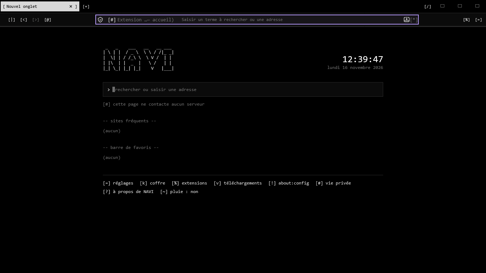
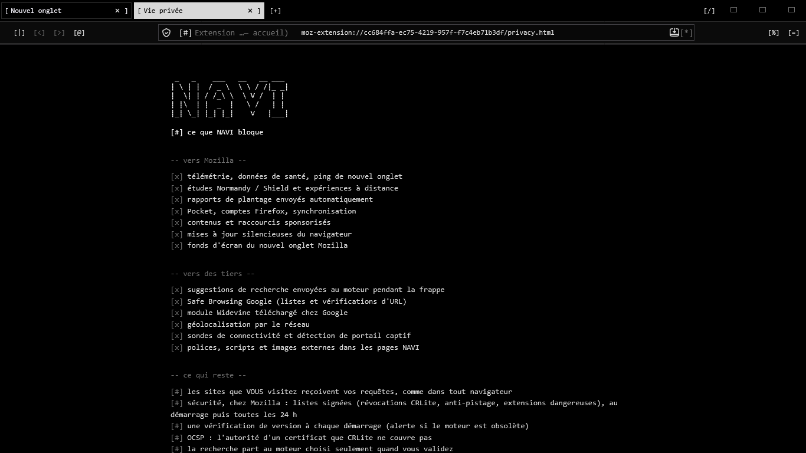
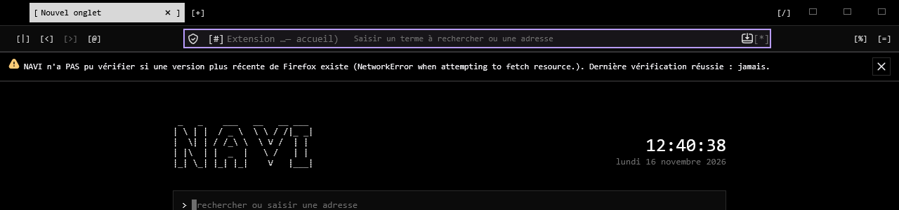

```
 _   _    ___   __   __ ___
| \ | |  / _ \  \ \ / /|_ _|
|  \| | / /_\ \  \ V /  | |
| |\  | |  _  |   \ /   | |
|_| \_| |_| |_|    V   |___|
```

# NAVI : installeur Windows

NAVI est un navigateur web pour Windows, réglé pour la vie privée, avec un thème noir et blanc façon terminal.

- **Moteur** : Gecko, le moteur de Firefox. L'installeur ne contient **pas** Firefox : il télécharge la version officielle
  chez Mozilla au moment de l'installation et la vérifie avant de l'utiliser.
- **Fait maison** : la configuration (télémétrie, études, Pocket, comptes, contenus sponsorisés coupés), le thème, la page
  de nouvel onglet, les pages NAVI et quatre extensions :
  - **NAVI Shield**, un bloqueur de traqueurs 100 % local ;
  - **NAVI accueil**, la page de nouvel onglet et les pages NAVI ;
  - **navi-claude**, le pont local qui permet à Claude, sur le même ordinateur, de piloter NAVI ;
  - **hello**, un exemple d'extension.
- Les sites modernes, les extensions Firefox, le gestionnaire de mots de passe et les outils de développement marchent
  comme dans Firefox.

NAVI n'est ni fait ni soutenu par Mozilla. Firefox est une marque de la Mozilla Foundation.

## Télécharger et vérifier

| Fichier | Rôle |
|---|---|
| `NAVI-Setup.exe` | l'installeur (environ 120 Ko) |
| `SHA256SUMS.txt` | son empreinte SHA-256 |

Pour vérifier le fichier, ouvre PowerShell dans le dossier du téléchargement et tape :

```powershell
Get-FileHash .\NAVI-Setup.exe -Algorithm SHA256
```

Le résultat doit être identique à la valeur de `SHA256SUMS.txt`.

**L'exécutable n'est pas signé** : Windows SmartScreen affichera « Windows a protégé votre ordinateur ».
Pour lancer quand même : **Informations complémentaires**, puis **Exécuter quand même**.
Ne le fais que si l'empreinte correspond.

## Prérequis

- Windows 10 ou 11, 64 bits.
- Aucun droit administrateur : tout s'installe pour ton compte seulement.
- Une connexion Internet pendant l'installation (environ 100 Mo à télécharger chez Mozilla) et environ 400 Mo d'espace disque.
- PowerShell 5.1 et .NET Framework 4, déjà présents dans Windows.
- **Python 3**, seulement pour le pont Claude. Le navigateur marche sans.
  L'installeur te prévient s'il manque. Pour l'ajouter : <https://www.python.org/downloads/>, en cochant
  « Add python.exe to PATH », puis relance l'installeur.

## Ce que fait l'installeur, étape par étape

1. Il demande le dossier d'installation. Par défaut : `%LOCALAPPDATA%\NAVI`.
   Si ce dossier contient déjà NAVI, c'est une **mise à jour**, et ton profil (favoris, mots de passe, historique) est gardé.
   Il refuse un dossier qui n'est pas vide et qui ne contient pas NAVI.
2. Il refuse de continuer si NAVI est ouvert.
3. Il copie les fichiers NAVI : configuration, thème, extensions, pont Claude, outils, icône et scripts.
4. Il demande la dernière version de Firefox à `product-details.mozilla.org`.
   Il refuse d'installer une version **plus ancienne** que celle déjà installée (protection anti-retour).
   Si la version installée est déjà la dernière, il ne télécharge rien et réapplique seulement la configuration NAVI.
5. Il télécharge chez `archive.mozilla.org` l'installeur officiel de Firefox (Windows 64 bits, en français) et son fichier
   d'empreintes `SHA256SUMS`.
6. Avant d'exécuter quoi que ce soit, il vérifie :
   - que le SHA-256 de l'installeur correspond à `SHA256SUMS` ;
   - que sa signature Authenticode est valide et que le signataire est bien **Mozilla Corporation**.
7. Il extrait Firefox, sans l'installer dans le système, puis il vérifie :
   - les signatures de `firefox.exe`, `xul.dll` et `updater.exe` ;
   - le numéro de version ;
   - le canal `firefox-mozilla-release`.
8. Il remplace le moteur sans jamais perdre celui qui marche. Le nouveau moteur est d'abord copié à part, puis échangé par
   deux renommages. En cas d'échec ou de coupure, l'ancien moteur est remis en place, à la fin du script ou au lancement suivant.
9. Il applique la configuration NAVI :
   - Les fichiers indispensables (`policies.json`, `autoconfig.js`, `navi.cfg`) sont obligatoires.
   - Il vérifie ensuite que leurs copies dans le moteur sont identiques, au SHA-256 près.
10. Il crée le raccourci **NAVI** sur le Bureau et dans le dossier d'installation, avec l'icône NAVI.
11. Il enregistre le pont Claude dans `HKCU\Software\Mozilla\NativeMessagingHosts\navi_bridge`.
    C'est la clé de ton compte, sans droits admin. Il te dit si Python 3 est présent ou non.

## Les domaines contactés

### Pendant l'installation

| Domaine | Quand | Ce qui est envoyé |
|---|---|---|
| `product-details.mozilla.org` | 1 fois | une requête GET de la liste publique des versions de Firefox |
| `archive.mozilla.org` | 1 fois (sauf si le moteur est déjà à jour) | deux GET : l'installeur Firefox (environ 96 Mo) et `SHA256SUMS` |

Ce sont des requêtes HTTPS ordinaires. Le serveur voit ton adresse IP et l'agent « PowerShell ». Aucun identifiant n'est envoyé.

### Pendant l'utilisation

Mesure réelle : NAVI fraîchement installé par cet installeur, profil neuf, laissé **30 minutes sans rien faire**.
Toutes les requêtes ont eu lieu dans les 31 premières secondes, puis plus rien. Il y en a eu 163, toutes vers Mozilla.
L'audit des connexions TCP n'a vu aucun autre serveur.

| Domaine | Quand | Pourquoi / ce qui est envoyé |
|---|---|---|
| `firefox.settings.services.mozilla.com` | au premier démarrage, puis toutes les 24 h | Remote Settings : demande des listes de sécurité signées (révocations de certificats CRLite, listes anti-pistage, extensions dangereuses…). 42 requêtes au premier démarrage. |
| `firefox-settings-attachments.cdn.mozilla.net` | idem | téléchargement des fichiers de ces listes : environ 20 Mo au premier démarrage, ensuite des mises à jour de quelques centaines de Ko. 81 requêtes. |
| `content-signature-2.cdn.mozilla.net` | idem | certificats servant à vérifier la signature de chaque liste. Une liste altérée est refusée. 39 requêtes. |
| `product-details.mozilla.org` | 1 fois par démarrage | alerte de version : liste publique des versions de Firefox, sans cookie ni cache. |
| autorité de certification d'un site (OCSP) | en visitant un site dont le certificat n'est pas couvert par CRLite | le numéro du certificat vérifié. L'autorité apprend donc quel site tu visites. |
| les sites que tu ouvres, et ton moteur de recherche (DuckDuckGo par défaut) | quand tu les utilises | comme dans tout navigateur. La recherche ne part que quand tu valides. |

Ces requêtes vers Mozilla ne portent ni cookie ni identifiant NAVI. Le serveur voit ton adresse IP et la version du moteur.
**Rien n'est envoyé à Google** : pas de Safe Browsing, et pas de téléchargement de Widevine.
**Pas de télémétrie, pas d'études, pas de rapports de plantage, pas de Pocket, pas de contenus sponsorisés.**

## Ce qui n'est PAS garanti

- **Pas de protection contre un logiciel malveillant déjà présent sur l'ordinateur.**
  Un programme qui tourne sous ton compte peut modifier NAVI, son profil ou ses scripts.
- **CRLite n'est pas une protection complète contre les certificats révoqués.**
  Lors des essais, 3 certificats révoqués de test sur 5 ont été refusés. Les 2 autres (SSL.com EV, DigiCert G5) ont été
  acceptés, même avec OCSP actif.
- **Safe Browsing est coupé** : aucun avertissement automatique contre le phishing ou les téléchargements malveillants.
  Une configuration prête à l'emploi est en commentaire dans `config\navi.cfg`, mais elle n'est pas activée.
- **L'installeur n'est pas signé** : il déclenche l'avertissement SmartScreen. Vérifie l'empreinte SHA-256.
- **Pas de mises à jour automatiques.** NAVI t'alerte au démarrage quand un Firefox plus récent existe : bandeau rouge et
  fenêtre d'alerte. Il affiche aussi un bandeau s'il n'a pas pu vérifier. Pour mettre à jour, relance l'installeur.
  Les extensions ne se mettent pas à jour seules non plus.
- **Le pont Claude a besoin de Python 3.**
- **La protection stricte contre le pistage peut casser certains sites.** Ajoute une exception pour le site avec le bouclier
  de la barre d'adresse.
- **Pas de DRM** : Netflix, Disney+, Spotify web et les autres services protégés ne liront pas leurs contenus.
- **Pas de traduction de pages ni d'IA intégrée.**

## Mettre à jour

Relance `NAVI-Setup.exe` et choisis le même dossier. Ton profil est gardé.
Une version de Firefox plus ancienne que celle installée est refusée.

## Désinstaller

NAVI fermé, ouvre PowerShell et tape (avec ton dossier d'installation) :

```powershell
powershell -ExecutionPolicy Bypass -File "$env:LOCALAPPDATA\NAVI\build\uninstall-windows.ps1"
```

Le script demande confirmation, puis demande s'il faut aussi supprimer le profil (favoris, mots de passe, historique).
Il retire le dossier, le raccourci du Bureau et la clé `navi_bridge`. Il ne touche au raccourci et à la clé que s'ils
pointent vers ce dossier.
Options :

- `-KeepProfile` garde `profile\` ;
- `-Yes` supprime sans poser de question, profil compris, sauf avec `-KeepProfile`.

## Installation sans question

Pour un déploiement, ces variables d'environnement remplacent les questions :

- `NAVI_INSTALL_DIR` : le dossier d'installation ;
- `NAVI_SHORTCUT_DIR` : le dossier du raccourci, au lieu du Bureau ;
- `NAVI_NOPAUSE=1` : pas de pause à la fin.

## Captures






