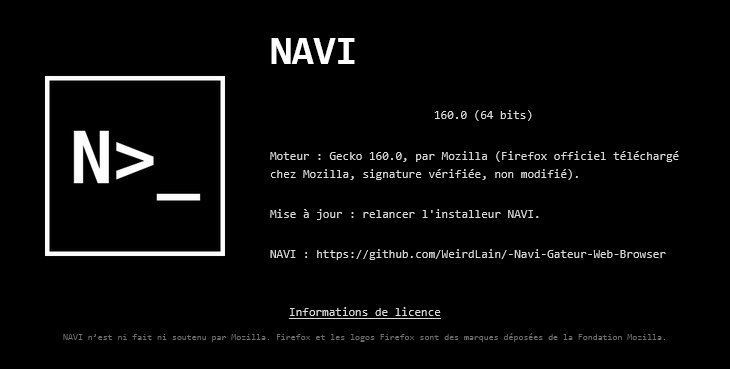
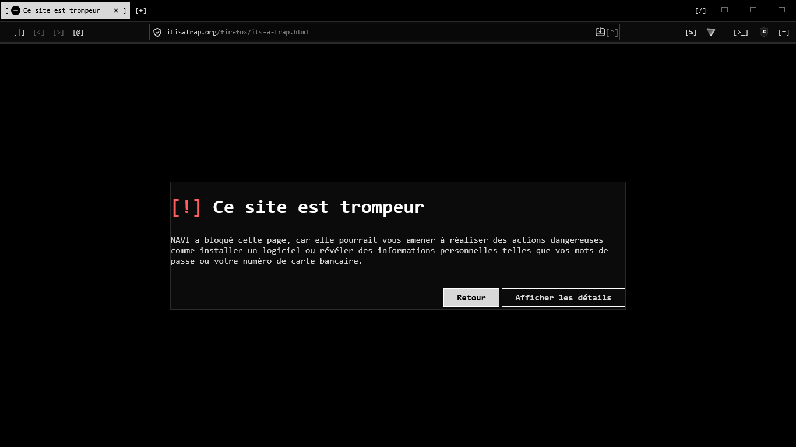
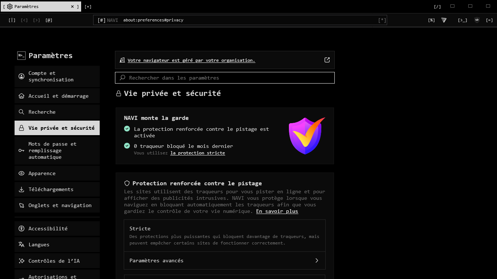

**English** | [Français](README.fr.md)

```
 _   _    ___   __   __ ___
| \ | |  / _ \  \ \ / /|_ _|
|  \| | / /_\ \  \ V /  | |
| |\  | |  _  |   \ /   | |
|_| \_| |_| |_|    V   |___|
```

# NAVI 1.1.0: Windows installer

NAVI is a privacy-tuned web browser for Windows, with a black-and-white terminal-style theme and its own name and logos.
Its interface is in French.

- **Engine**: Gecko, Firefox's engine, **by Mozilla**. The installer does **not** contain Firefox: it downloads the
  official release from Mozilla at install time, checks its hash and signature, and does not modify it.
- **Home-made**: the configuration, the NAVI name and logos, the theme, the new tab page, the NAVI pages and four
  extensions:
  - **NAVI Shield**, a 100% local tracker blocker, active from the first second and offline;
  - **NAVI home**, the new tab page and the NAVI pages;
  - **navi-claude**, the local bridge that lets Claude, on the same computer, drive NAVI;
  - **hello**, a sample extension.
- **Installed on first start from addons.mozilla.org** (not bundled in the installer, signed by Mozilla, updated
  automatically):
  - **uBlock Origin**, ad blocker, by Raymond Hill;
  - **Proton VPN**, Proton AG's official extension, **off** until you connect it with your Proton account.
- Modern websites, Firefox extensions, the password manager and the developer tools work as in Firefox.

**NAVI is not made or endorsed by Mozilla, by Proton AG, or by the author of uBlock Origin.** Firefox is a trademark of
the Mozilla Foundation; Proton VPN is a trademark of Proton AG.

## What's new in 1.1.0

- **NAVI name and logos everywhere** (see "Debranding"), honest About box: "Engine: Gecko, by Mozilla".
- **Dangerous sites blocked**: Google Safe Browsing enabled (phishing, malware, unwanted software), **without** sending
  downloaded files to Google.
- **HTTPS-Only**, HTTP downloads from HTTPS pages blocked, every downloaded file scanned by the Windows antivirus.
- **Ad blocker**: uBlock Origin, in private browsing too.
- **Proton VPN** ready, on or off as you choose (toolbar button).
- Extensions now update themselves.

## Download and verify

| File | Purpose |
|---|---|
| `NAVI-Setup.exe` | the installer (about 175 KB) |
| `SHA256SUMS.txt` | its SHA-256 hash |

To check the file, open PowerShell in the download folder and type:

```powershell
Get-FileHash .\NAVI-Setup.exe -Algorithm SHA256
```

The result must match the value in `SHA256SUMS.txt`.

**The executable is not signed**: Windows SmartScreen will show "Windows protected your PC".
To run it anyway: **More info**, then **Run anyway**. Only do so if the hash matches.

## Requirements

- Windows 10 or 11, 64-bit.
- No administrator rights: everything is installed for your account only.
- An Internet connection during installation (about 100 MB downloaded from Mozilla) and about 400 MB of disk space.
- PowerShell 5.1 and .NET Framework 4, already part of Windows.
- **Python 3**, only for the Claude bridge. The browser works without it.
  The installer tells you if it is missing: <https://www.python.org/downloads/>, ticking "Add python.exe to PATH".

## What the installer does, step by step

1. It asks for the install folder. Default: `%LOCALAPPDATA%\NAVI`.
   If that folder already contains NAVI, this is an **update** and your profile (bookmarks, passwords, history) is kept.
   It refuses a folder that is not empty and does not contain NAVI.
2. It refuses to continue while NAVI is open.
3. It copies the NAVI files: configuration, name and logos, theme, NAVI extensions, Claude bridge, tools, icon and scripts.
4. It asks `product-details.mozilla.org` for the latest Firefox version.
   It refuses to install a version **older** than the one already installed (anti-rollback).
   If the installed version is already the latest, it downloads nothing and only reapplies the NAVI configuration.
5. It downloads from `archive.mozilla.org` the official Firefox installer (Windows 64-bit, French) and its `SHA256SUMS`
   file.
6. Before running anything, it checks that the installer's SHA-256 matches `SHA256SUMS`, that its Authenticode signature
   is valid and that the signer is **Mozilla Corporation**.
7. It extracts Firefox, without installing it system-wide, then checks the signatures of `firefox.exe`, `xul.dll` and
   `updater.exe`, the version number and the `firefox-mozilla-release` channel. **No Mozilla file is modified.**
8. It replaces the engine without ever losing the working one (separate copy, then two renames; back to the old one on
   failure or power cut).
9. It applies the NAVI configuration next to the engine: `policies.json`, `autoconfig.js`, `navi.cfg` (mandatory,
   checked byte for byte with SHA-256) and the `navi-branding\` folder (name and logos).
10. It creates the **NAVI** shortcut on the Desktop, in the Start menu and in the install folder, with the NAVI icon and
    NAVI's Windows identity (so a pinned taskbar item is called NAVI). It does **not** make NAVI the default browser.
11. It registers the Claude bridge in `HKCU\Software\Mozilla\NativeMessagingHosts\navi_bridge` (your account's key, no
    admin rights) and tells you whether Python 3 is present.

On first start, Firefox installs uBlock Origin and Proton VPN from addons.mozilla.org (`ExtensionSettings` enterprise
policy): both are allowed in private browsing and pinned to the toolbar. Proton VPN opens its local welcome page once
(crash reports unticked by default).

Why Proton VPN is allowed in private browsing: it routes traffic through the browser-wide proxy setting
(`proxy.settings`), which Firefox only lets extensions with private-browsing access change; without that permission the
extension itself asks for it and private windows would not go through the VPN. While the VPN is off, this permission
lets it see nothing more than the pages you open.

## Debranding

NAVI replaces the "Firefox" name and logos **without modifying any Mozilla file**: brand strings (window titles, About,
settings, error pages, private browsing, protections dashboard), logos and icons of internal pages, icon and Windows
identity of every window, "help" and "learn more" links pointing to this page, fox illustration removed from error
pages, Help menu without Mozilla's services.

What remains, honestly:

- **Task Manager shows "Firefox"**: that is the name stored in the program signed by Mozilla, which is not modified
  (its signature is checked).
- **The User-Agent stays Firefox's**: changing it would make you easier to recognize and would break websites.
- The About box says "Engine: Gecko, by Mozilla" and the legal line "Firefox is a trademark of the Mozilla Foundation".
- A few Firefox texts mention Mozilla because they really are about Mozilla (telemetry settings, switched off and
  locked; "Search addons.mozilla.org"; the licenses page), one about:addons tooltip still says "Firefox only
  recommends…", and `about:policies` lists the technical policy names (`DisableFirefoxStudies`…).

## Domains contacted

### During installation

| Domain | When | What is sent |
|---|---|---|
| `product-details.mozilla.org` | once | a GET of the public list of Firefox versions |
| `archive.mozilla.org` | once (unless the engine is already up to date) | two GETs: the Firefox installer (about 96 MB) and `SHA256SUMS` |

These are ordinary HTTPS requests. The server sees your IP address and the "PowerShell" agent. No identifier is sent.

### While browsing

Real measurement: NAVI freshly installed by this installer, new profile, left **idle for 30 minutes**
(185 requests, **all within the first 36 seconds**, then nothing for 29.5 minutes; 13 TCP connections, all to the servers below).

| Domain | When | Why / what is sent |
|---|---|---|
| `firefox.settings.services.mozilla.com` | on first start, then every 24 h | Remote Settings: signed security lists (CRLite revocations, tracking protection, dangerous extensions…). 43 requests. |
| `firefox-settings-attachments.cdn.mozilla.net` | same | the files of those lists: about 20 MB on first start, then a few hundred KB. 82 requests. |
| `content-signature-2.cdn.mozilla.net` | same | certificates that check each list's signature (a tampered list is refused). 40 requests. |
| `product-details.mozilla.org` | once per start | version alert: public list of Firefox versions, no cookie, no cache. 1 request. |
| `safebrowsing.googleapis.com` | at start, then about every 30 min | Google Safe Browsing v5: update of the hash-prefix lists (Firefox's public API key is in the URL). 1 request in the measured window. Plus a full-hash request when a visited address matches a prefix. |
| `addons.mozilla.org` | on first start | download of uBlock Origin and Proton VPN (files signed by Mozilla). 2 requests (+ redirects). |
| `versioncheck-bg.addons.mozilla.org` | on first start, then once a day | extension updates: the ID and version of each AMO extension, the engine version. 2 requests. |
| `ublockorigin.github.io`, `ublockorigin.pages.dev`, `cdn.jsdelivr.net`, `filters.adtidy.org`, `pgl.yoyo.org`, `malware-filter.gitlab.io`, `publicsuffix.org` | on first start, then when a list expires (usually every few days) | uBlock Origin: download of its filter lists. 13 requests. |
| `account.proton.me` | each time the extension starts, **even with the VPN off** | Proton VPN: `GET /api/vpn/servers-count` (public server count), no account. 1 request. |
| a site's certificate authority (OCSP) | when visiting a site whose certificate is not covered by CRLite | the serial of the checked certificate: the authority learns which site you visit |
| the sites you open, and your search engine (DuckDuckGo by default) | when you use them | as in any browser; a search is only sent when you press Enter |
| `account.proton.me` and Proton's VPN servers | **only if you turn Proton VPN on** | your account login, then all your web traffic goes through Proton (that is the point) |

These requests carry no cookie and no NAVI identifier. Each server sees your IP address, the engine version and ordinary
fingerprinting elements (Firefox's TLS/HTTP headers).
**Google** (Safe Browsing) additionally sees, when a page address looks like a flagged one, a few 4-byte hash prefixes
(not the address itself). Nothing is sent to `sb-ssl.google.com`: **no information about downloaded files goes to Google.**
**No telemetry, no studies, no crash reports, no Pocket, no sponsored content.**

## What is NOT guaranteed

- **No complete protection against malware** (it does not exist). Safe Browsing only blocks addresses **already
  flagged** to Google or Mozilla: new malware, or malware hosted at a not-yet-known address, is not detected. Real test:
  Google's and Mozilla's phishing and malware test pages are blocked, but **Google's test files ("bad URL"
  `content.exe`, `badrep.exe`, `pua.exe`…) are not**, because Google only flags them through the remote download
  check, which is switched off so nothing is sent to it. Only the Windows antivirus scans files: **keep Microsoft
  Defender on and up to date.**
- **No protection against malware already on the computer.**
  A program running under your account can read or change NAVI, its profile or its scripts.
- **CRLite is not complete protection against revoked certificates**: in tests, 3 of 5 revoked test certificates were
  refused; the other 2 (SSL.com EV, DigiCert G5) were accepted, even with OCSP enabled.
- **The installer is not signed**: SmartScreen warning. Check the SHA-256 hash.
- **Task Manager still shows "Firefox"** (see "Debranding").
- **Proton VPN needs a Proton account** (free or paid), which you create yourself at Proton. NAVI does not create or
  connect it for you. While off, it protects nothing.
- **No automatic engine updates.** NAVI warns you at startup when a newer Firefox exists (red bar and dialog), or if it
  could not check. To update, run the installer again. Extensions, on the other hand, update themselves.
- **Strict tracking protection can break some sites**: add an exception with the shield in the address bar. Same for
  HTTPS-Only ("Continue to HTTP site" button).
- **The Claude bridge needs Python 3.**
- **No DRM**: Netflix, Disney+, Spotify web and other protected services will not play their content.
- **No page translation and no built-in AI.**

## Update

Run `NAVI-Setup.exe` again and choose the same folder. Your profile is kept.
A Firefox version older than the installed one is refused.

## Uninstall

With NAVI closed, open PowerShell and type (with your install folder):

```powershell
powershell -ExecutionPolicy Bypass -File "$env:LOCALAPPDATA\NAVI\build\uninstall-windows.ps1"
```

The script asks for confirmation, then whether to delete the profile too (bookmarks, passwords, history).
It removes the folder, the Desktop and Start menu shortcuts and the `navi_bridge` key, only if they point to that folder.
Options: `-KeepProfile` keeps `profile\`; `-Yes` deletes without asking (profile included, unless `-KeepProfile`).

## Unattended install

For deployment, these environment variables replace the questions:

- `NAVI_INSTALL_DIR`: the install folder;
- `NAVI_SHORTCUT_DIR`: the shortcut folder, instead of the Desktop;
- `NAVI_STARTMENU_DIR`: the Start menu shortcut folder;
- `NAVI_NOPAUSE=1`: no pause at the end.

## Screenshots

Taken on a new profile, right after installation (the interface is in French).

![NAVI new tab, with uBlock Origin, Proton VPN and [>_] in the toolbar](captures/nouvel-onglet.png)








